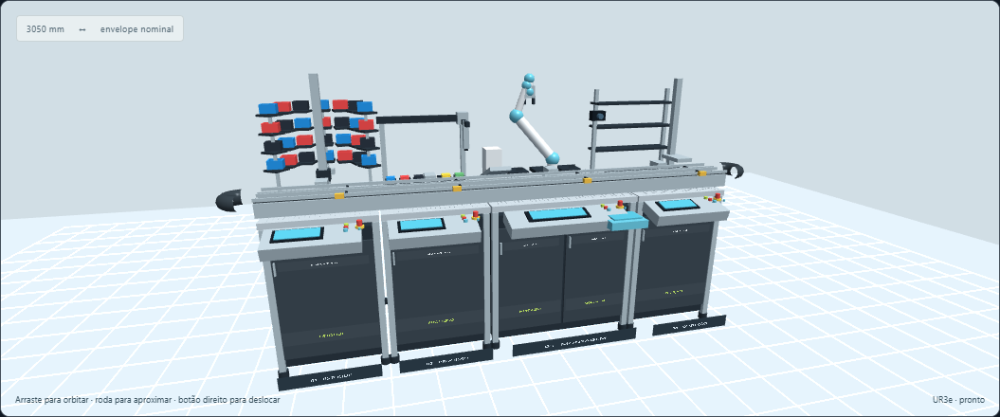

# Gêmeo digital da planta N2 · SMART 4.0

Simulação local da planta didática XL4002: estoque, processo, montagem e expedição. Inclui visualização 3D, receitas de 1–3 andares, operação manual, monitoramento de I/O, injeção de falhas e ensaios de comissionamento virtual.



## Executar

Requer **Node.js 22.12 ou superior** e navegador com WebGL.

```sh
git clone https://github.com/tonymarim/gemeo-digital-planta-N2.git
cd gemeo-digital-planta-N2
npm start
```

Abra **http://127.0.0.1:4173**. No Windows também é possível executar `INICIAR.cmd`.

A versão compilada está em `dist/`: não é necessário instalar dependências para executar. Não abra o HTML diretamente, pois a interface depende do servidor local. A sessão fica na memória; exporte os resultados antes de encerrar.

## Recursos

- Quatro estações em 3D, com navegação e seleção de vistas.
- Receitas de um a três andares, três lâminas por andar, inspeção, tampa e expedição.
- 73 sinais: 52 com endereços documentados e 21 lógicos.
- 106 poses e 23 comandos extraídos do programa de robô fornecido.
- Operação manual, forças de entrada, falhas, rearme e execução por etapas.
- 17 ensaios funcionais no painel e um teste adicional do mapa I/O.
- Rastreio CSV e relatório de comissionamento JSON.

## Documentação e evidências

- [Guia completo, fontes, decisões e limitações](LEIA-ME.md)
- [Mapa I/O](data/io-map.csv)
- [Relatório dos ensaios](reports/commissioning-latest.json)
- [Resultado do teste de navegador](reports/browser.json)
- [Pacote ZIP da entrega](entrega/N2-gemeo-digital-local.zip)

## Testar e desenvolver

```sh
npm test
```

Para modificar e recompilar a interface:

```sh
npm install
npm run build
npm start
```

O servidor e o modelo usam módulos nativos do Node.js. Babylon.js e Vite são necessários apenas para recompilar a interface. Consulte o guia para executar os testes de navegador e reextrair os dados documentais.

## Escopo e fidelidade

Esta versão realiza **simulação e comissionamento do modelo local**. Não está conectada a CLPs, robô, MES ou serviços externos. Geometria sem cotas e tempos são aproximações; o robô reproduz pontos de percurso com elos ilustrativos, sem cinemática UR, dinâmica ou validação de colisões. Não equivale a uma réplica física calibrada nem valida segurança funcional.

Os manuais e demais anexos originais do fabricante **não estão neste repositório**. Para usar os links de consulta no aplicativo e a extração documental, coloque a pasta `N2` ao lado da pasta do projeto, conforme o guia. A simulação funciona sem esses anexos; seus hashes e as referências técnicas usadas estão em `data/`.

As dependências mantêm suas próprias licenças; a licença do Babylon.js incluído está em `dist/licenses/babylon.md`.
